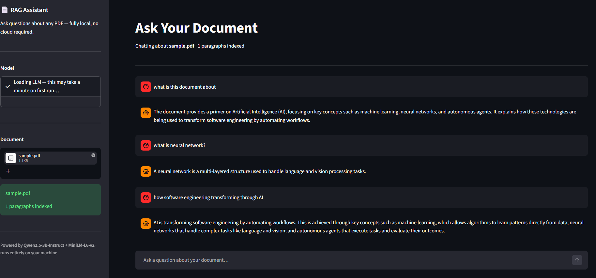

::: {align="center"}

# 📄 Local PDF RAG Assistant

**Chat with your PDFs using a locally running language model.**

Upload a PDF, ask questions in natural language, and receive streamed
answers grounded in the document's extracted content.


:::

---

## ✨ Overview

**Local PDF RAG Assistant** is a document-question-answering application
built with Python and Streamlit. It extracts text from uploaded PDF
files, converts document paragraphs into embeddings, retrieves relevant
passages for a question, and sends that context to a local
instruction-tuned language model to generate an answer.

The app streams generated text into a chat interface and reuses the
document's in-memory vector index for follow-up questions during the
current session.

> **Privacy note:** Model inference and document retrieval run on your
> machine. The application uses Hugging Face to authenticate and
> download model files when needed, so initial setup requires internet
> access. Avoid uploading confidential documents unless you have
> reviewed your environment and dependencies.

## 🖥️ Application Preview

Here's a look at the Local PDF RAG Assistant in action.

<div align="center">
  
</div>

_Upload a PDF, ask questions in natural language, and receive AI-generated answers grounded in the document's content._

## 🚀 Features

- **PDF upload:** Upload a PDF through the Streamlit sidebar.
- **Text extraction:** Extracts text from PDF pages with `pypdf` and
  normalizes whitespace.
- **Semantic retrieval:** Creates embeddings with
  `sentence-transformers/all-MiniLM-L6-v2`.
- **In-memory vector search:** Retrieves the closest passages using
  cosine or Euclidean distance.
- **Local LLM inference:** Uses the Qwen instruction model through
  Hugging Face Transformers.
- **Streaming responses:** Displays generated answers incrementally
  instead of waiting for the full response.
- **Document-grounded prompting:** Instructs the model to use the
  retrieved context and acknowledge when the context does not contain
  an answer.
- **Session chat history:** Keeps the conversation visible while the
  current Streamlit session is active.
- **Index reuse:** Reuses the indexed document for subsequent
  questions until another PDF is selected.

## 🧠 How It Works

```text
                 ┌───────────────────┐
                 │    Upload PDF     │
                 └─────────┬─────────┘
                           │
                           ▼
                 ┌───────────────────┐
                 │  PDF text parsing │
                 │      pypdf        │
                 └─────────┬─────────┘
                           │
                           ▼
                 ┌───────────────────┐
                 │ Paragraph chunks  │
                 └─────────┬─────────┘
                           │
                           ▼
                 ┌───────────────────┐
                 │ Local embeddings  │
                 │ MiniLM-L6-v2      │
                 └─────────┬─────────┘
                           │
                           ▼
                 ┌───────────────────┐
                 │ In-memory vector  │
                 │ index + retrieval │
                 └─────────┬─────────┘
                           │ Relevant context
                           ▼
                 ┌───────────────────┐
                 │ RAG prompt + Qwen │
                 │ local generation  │
                 └─────────┬─────────┘
                           │
                           ▼
                 ┌───────────────────┐
                 │ Streamlit chat UI │
                 │ streamed answer   │
                 └───────────────────┘
```

### Retrieval-Augmented Generation (RAG) flow

1.  The user uploads a PDF.
2.  The app extracts text and splits it into paragraph-level units.
3.  The embedding model converts each paragraph into a vector.
4.  The vector index ranks passages by distance from the question
    embedding.
5.  The top retrieved passages are inserted into a grounded prompt.
6.  The local Qwen model generates an answer, which is streamed to the
    UI.

## 🧰 Tech Stack

---

Component Technology Purpose

---

User interface Streamlit PDF upload and chat
interface

PDF parsing pypdf Extract text from PDF
pages

Embeddings Hugging Face Convert text into
Transformers + MiniLM vectors

Vector retrieval Custom `VectorIndex` In-memory similarity
search

Language model Qwen2.5 Instruct Generate answers from
retrieved context

Inference PyTorch Run model inference

Configuration python-dotenv Load the Hugging Face
token from `.env`

---

## 📁 Project Structure

```text
RAG_P1/
├── .streamlit/
│   └── config.toml          # Streamlit configuration
├── pdfs/
│   └── ...                  # Optional sample PDFs
├── local_embedding.py       # Embedding generation and retrieval integration
├── local_llm.py             # Local LLM loading, RAG prompt, and streaming
├── main.py                  # Streamlit application entry point
├── pdf_reader.py            # PDF text extraction and paragraph preparation
├── vector_index.py          # In-memory cosine/Euclidean vector search
├── requirements.txt         # Python dependencies
├── .env                     # Local secrets; do not commit
└── .gitignore
```

## ⚙️ Getting Started

### 1. Prerequisites

- Python 3.11 or newer is recommended; use a Python version compatible
  with the installed PyTorch and Transformers packages.
- Git
- Internet access for initial model/tokenizer downloads
- Enough RAM and disk space for the selected language model and
  embedding model

**CPU note:** The current implementation explicitly loads the language
model on CPU. Model loading and response generation can be slow on
machines without a supported GPU, especially for larger PDFs or longer
answers.

### 2. Clone the repository

```bash
git clone <YOUR_GITHUB_REPOSITORY_URL>
cd RAG_P1
```

Replace `<YOUR_GITHUB_REPOSITORY_URL>` with your repository URL.

### 3. Create and activate a virtual environment

**Windows PowerShell**

```powershell
python -m venv .venv
.\.venv\Scripts\Activate.ps1
```

**macOS / Linux**

```bash
python3 -m venv .venv
source .venv/bin/activate
```

### 4. Install dependencies

```bash
python -m pip install --upgrade pip
pip install -r requirements.txt
```

PyTorch installation can vary by operating system and hardware. If the
pinned PyTorch build in `requirements.txt` is unavailable for your
platform, install a compatible PyTorch build using the official PyTorch
installation selector, then install the remaining requirements.

### 5. Configure your Hugging Face token

The application reads `HF_TOKEN` from a local `.env` file for Hugging
Face authentication.

Create a `.env` file in the project root:

```env
HF_TOKEN=your_hugging_face_read_token
```

Use your own token and keep it private. Never paste a real token into
the README, commit it to Git, or share it in screenshots. The `.env`
file should be ignored by Git.

### 6. Run the application

```bash
streamlit run main.py
```

Streamlit will print a local address in the terminal. Open that address
in your browser, upload a PDF from the sidebar, wait for indexing to
finish, and ask a question in the chat box.

## 💬 Example Questions

After uploading a text-based PDF, try questions such as:

- "Summarize the main points of this document."
- "What are the key dates or figures mentioned?"
- "Explain the main conclusion in simple terms."
- "Which risks or limitations does the document discuss?"
- "What does the document say about \[your topic\]?"

Answers depend on the quality of the PDF's extracted text and the
passages retrieved by the application.

## 🗂️ Core Modules

### `main.py`

Creates the Streamlit interface, handles PDF uploads, maintains session
chat history, builds the document index, and streams model output.

### `pdf_reader.py`

Uses `pypdf` to extract text from PDF pages, normalize whitespace, and
expose extracted text as paragraph-level strings.

### `local_embedding.py`

Loads `sentence-transformers/all-MiniLM-L6-v2` through Transformers,
mean-pools token embeddings, normalizes vectors, and uses the vector
index to retrieve relevant content.

### `vector_index.py`

Implements a lightweight in-memory vector store. It supports cosine and
Euclidean distance, validates vector dimensions, and returns the nearest
documents in ascending distance order.

### `local_llm.py`

Authenticates with Hugging Face, loads the Qwen instruction model,
prepares prompts, retrieves relevant PDF passages, and supports streamed
text generation.

## ⚠️ Current Limitations

- **In-memory index:** Document vectors are not persisted between
  application restarts.
- **Paragraph-level retrieval:** The current text splitting is
  paragraph-based rather than token-aware chunking with overlap.
- **PDF extraction quality:** Scanned/image-only PDFs may require OCR,
  which is not currently implemented.
- **Retrieval quality:** The app uses a basic custom vector index and
  does not include reranking or a dedicated vector database.
- **CPU performance:** Local generation may be slow on CPU-only
  hardware.
- **Context limits:** Very long or poorly structured documents can
  reduce retrieval and answer quality.
- **Grounding is not guaranteed:** Prompt instructions reduce
  unsupported answers but do not eliminate hallucinations. Verify
  important answers against the original PDF.
- **Temporary files:** Uploaded PDFs are written to temporary files.
  Review cleanup behavior and deployment security before using this
  with sensitive documents.

## 🔐 Security

- Keep `.env` out of version control.
- If a token has ever been exposed in a chat, screenshot, log, or
  public repository, revoke it and create a replacement.
- Use a token with only the permissions required by your workflow.
- Do not commit private PDFs, model credentials, virtual environments,
  cache folders, or generated artifacts.
- Before deploying the app for other users, add appropriate upload
  limits, error handling, temporary-file cleanup, and access controls.

## 🛣️ Potential Improvements

- Add token-aware chunking with overlap.
- Persist embeddings and metadata between sessions.
- Add source citations/page references to each answer.
- Support scanned PDFs with OCR.
- Add retrieval evaluation and a small test dataset.
- Add better error handling for empty PDFs, unsupported documents, and
  failed model downloads.
- Provide model/device configuration and progress indicators.
- Add automated tests and a reproducible environment setup.

## 🤝 Contributing

Contributions and suggestions are welcome. For substantial changes, open
an issue first to discuss the proposed improvement, then submit a
focused pull request.

## 📄 License

No license is currently specified. Add a `LICENSE` file before
distributing or reusing this project publicly.

---

::: {align="center"}
**Built with Python, Streamlit, Transformers, and a practical RAG
pipeline.**
:::
